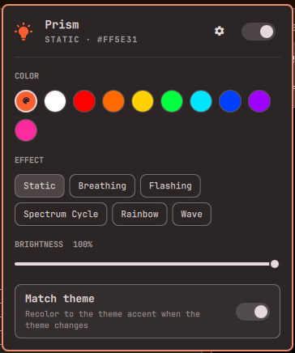
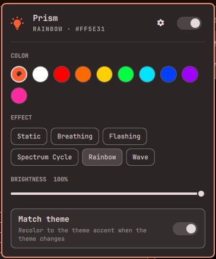
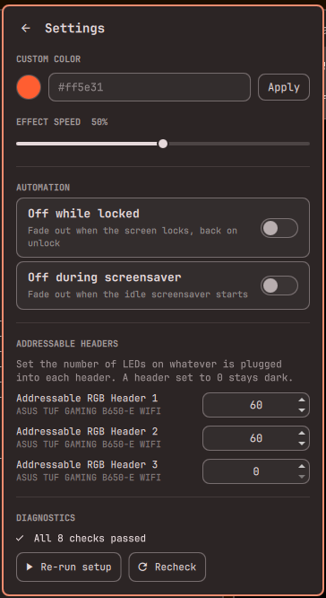

# Prism

Control all the ARGB/RGB lighting in your PC from the [Omarchy](https://omarchy.org)
bar: motherboard headers, RAM, GPU, LED strips and fans — anything
[OpenRGB](https://openrgb.org) supports.

- **One-click panel** in the bar: power, color swatches (including your theme's
  accent, boosted ~50% in saturation and brightness, with teal-greens nudged toward true green, so it doesn't wash out or turn blue on LEDs), effects and brightness.
- **Truly synced effects.** Rainbow, Spectrum Cycle, Breathing, Flashing and Wave run from a
  single clock, so RAM, fans and strips stay in lockstep. Hardware effects can't do
  this because every controller keeps its own timing.
- **Settings menu** for everything else: custom hex color, effect speed, matching the
  theme accent, turning the lights off while the screen is locked or the screensaver
  runs, and LED counts for each addressable header.
- **Survives reboots.** Your lighting is restored at login and after OpenRGB restarts.
- **Scriptable** with the `omarchy-prism` CLI.

## Screenshots

<p>
  
  
  
</p>

Main panel (left, middle) and settings (right). The status line under the title rotates
through playful phrases while the lights are on.

## Requirements

- Omarchy (the shell plugin system), Python 3.9+
- [OpenRGB](https://openrgb.org) (tested with 1.1; `setup` installs it for you on Arch)
- Hardware that OpenRGB supports. Check the
  [supported devices list](https://openrgb.org/devices_0.9.html).
  Developed and tested on an ASUS TUF GAMING B650-E WIFI (Aura USB controller) with ENE DRAM
  RAM. Other hardware should work wherever OpenRGB does, but hasn't been tried; please open an
  issue with the output of `omarchy-prism doctor` if something misbehaves.

## Install

```bash
omarchy plugin add https://github.com/jram0421/prism.git --enable --yes
~/.config/omarchy/plugins/jram0421.prism/bin/omarchy-prism setup
```

`setup` is safe to re-run. It installs OpenRGB if missing (asks for sudo), creates a
private Python environment for the `openrgb-python` library, and installs and starts two
user services (`openrgb-server`, `omarchy-prism`), the `omarchy-prism` command in
`~/.local/bin`, and the theme hook. You can also click **Run setup** in the panel.

Then open the panel (the bulb icon), click the gear, and set the **LED count of
each addressable header** to match what's plugged in (for example 3 fans × 8 LEDs = 24).
Headers start at 0 and stay dark until you do.

Right-click the bulb to toggle the lights. A keybinding can open the panel with
`quickshell ipc -p /usr/share/omarchy/shell call jram0421.prism toggle`
(`open`, `close` and `settings` also work).

## CLI

```text
omarchy-prism status [--json]        current settings and service state
omarchy-prism color <hex|name|theme> e.g. ff2a9d, red, or the theme accent
omarchy-prism mode <name>            Static, Breathing, Flashing, Spectrum Cycle, Rainbow, Wave
omarchy-prism brightness <0-100>
omarchy-prism speed <0-100>
omarchy-prism on | off | toggle
omarchy-prism follow on|off          match the theme accent on theme change
omarchy-prism auto-off lock|screensaver on|off
omarchy-prism zone "Header 1" 24     LED count of an addressable header
omarchy-prism devices                everything OpenRGB found
omarchy-prism doctor                 diagnose problems, with fixes
omarchy-prism setup | uninstall [--purge]
```

Settings live in `~/.config/omarchy-prism/config.json`.

## How it works

```
panel / CLI ──writes──▶ config.json ◀──watches── engine (omarchy-prism.service)
                                                    │  computes every frame, one clock
                                                    ▼
                                      OpenRGB server (openrgb-server.service)
                                                    ▼
                                   RAM · motherboard · strips · fans · GPU
```

The engine is the only thing that talks to the hardware. It also handles Static and Off,
which is why lighting comes back after login, resume or an OpenRGB restart. It sleeps
between writes when nothing is animating (≈0% CPU) and runs at 30 fps during effects.

## Troubleshooting

Run `omarchy-prism doctor`. It checks the OpenRGB install, udev rules, I2C access, the
Python library, both services and device detection, and prints the fix for anything wrong.
The panel's settings page shows the same results.

- **RAM isn't detected.** It needs I2C. Enable the module at boot:
  `echo i2c-dev | sudo tee /etc/modules-load.d/i2c-dev.conf && sudo modprobe i2c-dev`.
  Some boards also need the SMBus driver (`i2c_piix4` on AMD, `i2c_i801` on Intel). See
  [OpenRGB's SMBus notes](https://openrgb.org).
- **A header stays dark.** Its LED count is probably 0. Set it in settings.
- **Logs:** `journalctl --user -u omarchy-prism -u openrgb-server`.
- **Another RGB program is running** (OpenRGB GUI, SignalRGB, vendor tools) and fighting
  over the same devices. Close it.

## Uninstall

```bash
omarchy-prism uninstall           # keeps your settings
omarchy-prism uninstall --purge   # also deletes settings and the Python environment
omarchy plugin remove jram0421.prism
```

## Development

The plugin is a QML panel (`Panel.qml`) plus one Python program (`bin/omarchy-prism`,
CLI and engine). Hot reload of QML can serve a cached compile after an error; if a
change doesn't show up, `omarchy restart shell`.

```bash
python3 -m unittest discover -s tests -v
```

Tests need no hardware. Plugins run as unsandboxed code inside the Omarchy shell; read
what you install.

## License

MIT
